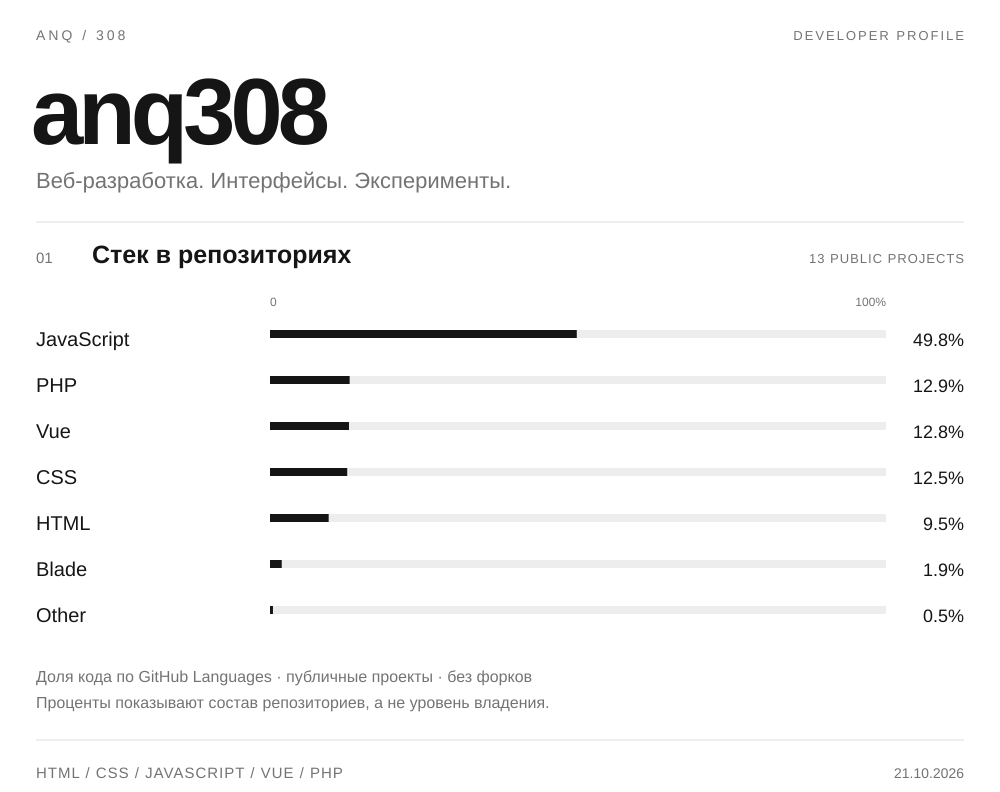

<picture>
  <source media="(prefers-color-scheme: dark)" srcset="./profile-dark.svg">
  <source media="(prefers-color-scheme: light)" srcset="./profile-light.svg">
  
</picture>

### 02 / Проекты

**[Yandexgmae](https://github.com/anq308/Yandexgmae)** &nbsp; · &nbsp; JavaScript &nbsp; / &nbsp; [Открыть сайт](https://yandexgmae.vercel.app/)

**[kyrsachPHP](https://github.com/anq308/kyrsachPHP)** &nbsp; · &nbsp; Vue / PHP

**[PPavantis](https://github.com/anq308/PPavantis)** &nbsp; · &nbsp; PHP

**[Pixel_sait](https://github.com/anq308/Pixel_sait)** &nbsp; · &nbsp; HTML / CSS

---

[Все репозитории](https://github.com/anq308?tab=repositories) &nbsp; / &nbsp; [Избранное](https://github.com/anq308?tab=stars) &nbsp; / &nbsp; [Данные графика](./language-source.json)
