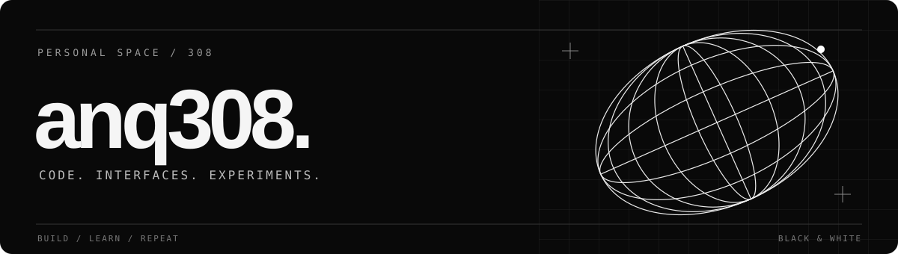

  

  <a href="https://github.com/anq308?tab=repositories">Репозитории</a> &nbsp; / &nbsp;
  <a href="#02--проекты">Проекты</a> &nbsp; / &nbsp;
  <a href="https://github.com/anq308?tab=stars">Избранное</a>

 

### 01 / Обо мне

Привет, я **anq308**. Здесь — мои веб-проекты, работа с интерфейсами и эксперименты с кодом.

Мне нравится превращать идеи в работающие страницы и пробовать разные подходы к разработке.

  <code>HTML</code> &nbsp; <code>CSS</code> &nbsp; <code>JavaScript</code> &nbsp; <code>PHP</code>

 

### 02 / Проекты

<table width="100%">
  <tr>
    <td width="50%" valign="top">
      01 / PHP
      <h3><a href="https://github.com/anq308/PPavantis">PPavantis</a></h3>
      
Исходный код проекта на PHP.

    </td>
    <td width="50%" valign="top">
      02 / HTML
      <h3><a href="https://github.com/anq308/Pixel_sait">Pixel_sait</a></h3>
      
Веб-проект и работа с вёрсткой.

    </td>
  </tr>
  <tr>
    <td width="50%" valign="top">
      03 / JAVASCRIPT
      <h3><a href="https://github.com/anq308/kursach">kursach</a></h3>
      
Проект с использованием JavaScript.

    </td>
    <td width="50%" valign="top">
      04 / HTML
      <h3><a href="https://github.com/anq308/notes">notes</a></h3>
      
Ещё один эксперимент с веб-страницами.

    </td>
  </tr>
</table>

<a href="https://github.com/anq308?tab=repositories">Все репозитории →</a>

---

  Меньше шума. Больше смысла. 
  <b>ANQ308</b> &nbsp; / &nbsp; BUILD · LEARN · REPEAT

